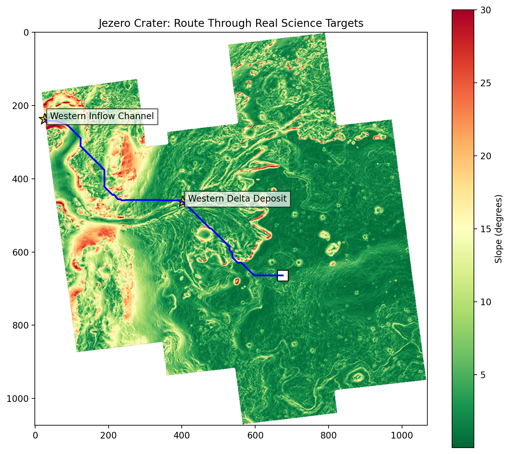

# MarsPath: Safe Route and Science Planner

A layered Martian map for the 2026 NASA Space Apps Challenge,
**"Interplanetary Survival Guide: Martian Map"**.

**Author:** Nishanthini M

## Problem
The first astronauts on Mars will need more than a flat image: they need to know
which route is safe, where the steep slopes are, which places are worth studying,
and how far they are from shelter. This project combines NASA Mars data into one
layered view of Jezero Crater to plan a Marswalk.

## What it does
- Calculates a slope hazard map of Jezero Crater from a HiRISE DTM
- Builds a hazard cost map (slope > 15 deg = risky, > 25 deg = no-go)
- Finds the safest walking route with A* (scikit-image)
- Routes through real science targets from the Mars Trek Jezero tour
- Shows a 5 km emergency return radius
- Exports an interactive layered map with toggleable layers

## Result
- Route: Landing Site (habitat) -> Western Delta Deposit -> Western Inflow Channel
- Total distance: 14.8 km, about 4.9 hours at 3 km/h

| Leg | Distance | Time | Max slope | Mean slope |
|---|---|---|---|---|
| Habitat -> Western Delta Deposit | 5.9 km | 2.0 hrs | 14.7 deg | 4.8 deg |
| Western Delta -> Western Inflow Channel | 8.9 km | 3.0 hrs | 15.0 deg | 8.0 deg |

| Science stop | Elevation | Slope at stop |
|---|---|---|
| Western Delta Deposit | -2428 m | 9.3 deg |
| Western Inflow Channel | -2291 m | 7.2 deg |

Both legs stay within the 15 deg risk threshold along the path.

## Files
- `marspath_notebook.ipynb`: full code (Google Colab)
- `jezero_map.html`: interactive layered map (download and open in a browser)
- `jezero_route_real.png`: route, science stops and return radius

## Map layers
Slope (hazard), Elevation, Safe route, Habitat and end point,
Science stops (with distance, elevation and slope), 5 km return radius.

## Data
- Mars Trek (trek.nasa.gov/mars): "MRO HiRISE, Jezero
